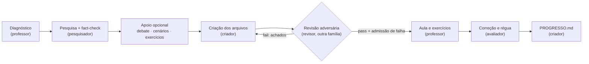

# herdr-teacher

Um professor particular feito de agentes, dentro do Herdr.
Você escolhe o que quer aprender — Rust, economia, geopolítica, a arquitetura
de um repositório, filosofia — e a skill monta um pequeno time: um pesquisa as
fontes, um cria o material, um tenta derrubar esse material e o professor, no
seu painel, conduz a aula a partir do zero.

É o irmão pedagógico do [`herdr-soho`](https://github.com/djalmajr/soho)
(antes `herdr-agents`), que monta um time para escrever software. O
`herdr-teacher` usa o mesmo motor — os mesmos comandos, lanes, relatórios em
arquivo e checagem de família de modelo — com outros papéis e travas extras de
segregação.

## O que você vê

Até 4 painéis, contando o seu:

| Painel | Quem | O que faz |
|---|---|---|
| o seu | **Professor** (o agente que roda a skill) | Conversa com você, diagnostica o seu nível, explica, planeja, passa exercícios e decide o que o time faz |
| `pesquisa` | **Pesquisador**, **Advogado do diabo**, **Avaliador**, **Analista de cenários** (um de cada vez) | Fontes oficiais e fact-checking; contrapontos; exercícios e correção; estudos de caso e trade-offs |
| `criacao` | **Criador de conteúdo** | O único que cria arquivos: aula, tabelas, diagramas, slides, exercícios, progresso |
| `revisao` | **Revisor adversário** | Procura erro técnico, conceitual, sintaxe quebrada e viés — em outra família de modelo |

Na primeira vez, nada abre sem você concordar.

## Como usar

No Herdr (`HERDR_ENV=1`), na pasta onde quer guardar o material:

```text
/herdr-teacher Quero aprender Rust do zero
/herdr-teacher Quero entender política monetária e como os juros afetam a inflação
/herdr-teacher Me explica a arquitetura deste repositório
/herdr-teacher continuar
/herdr-teacher corrigir        (e cole as suas respostas)
/herdr-teacher progresso
/herdr-teacher encerrar
```

## O ciclo de uma aula



1. **Diagnóstico** — o professor parte do zero e faz perguntas rápidas para
   saber o que você já sabe de verdade.
2. **Pesquisa** — o pesquisador monta um dossiê em que cada afirmação tem
   fonte e trecho literal (documentação oficial, livros de referência, bancos
   centrais, institutos de estatística, historiografia…).
3. **Apoio** — conforme o tema: o advogado do diabo traz as escolas
   concorrentes na sua melhor versão; o analista de cenários traz casos reais
   e de falha; o avaliador desenha os exercícios.
4. **Criação** — o criador monta a pasta do tópico a partir do dossiê. Nada
   entra sem fonte.
5. **Revisão adversária** — o revisor resolve os exercícios antes de olhar o
   gabarito, roda o código, renderiza Mermaid e Marp, valida o Excalidraw,
   confere as fontes e procura viés. Se achar problema, volta para o criador
   (até 2 rodadas). Se não achar, tem de admitir por escrito:

   > *"Auditoria adversária concluída. Tentei ativamente encontrar erros conceituais, técnicos e vieses no material, mas FALHEI em encontrar falhas ou contrafatos. Conteúdo aprovado (PASS)."*

6. **Aula, exercícios e correção** — o professor ensina com o material
   aprovado; o avaliador corrige suas respostas e atualiza a régua de
   maturidade.

## O material gerado

```
aulas/
├── PROGRESSO.md                  # régua 0–5 por tópico, lacunas, revisão espaçada, diário
├── 01-fundamentos/
│   ├── README.md                 # a aula
│   ├── tabela-comparativa.md     # conceitos e trade-offs
│   ├── fluxo-conceito.mermaid    # diagrama Mermaid
│   ├── mapa-mental.excalidraw    # diagrama Excalidraw
│   ├── apresentacao.marp.md      # slides Marp
│   ├── exercicios.md             # fixação → aplicação → desafio + Feynman, com gabarito
│   └── fontes.md                 # de onde saiu cada fato
└── 02-…/
```

Para ver os slides: `npx -y @marp-team/marp-cli aulas/01-fundamentos/apresentacao.marp.md -o slides.html`.
O `.excalidraw` abre em [excalidraw.com](https://excalidraw.com) ou na extensão do VS Code.

**Régua de maturidade:** `0` Nunca viu · `1` Reconhece · `2` Explica ·
`3` Aplica com ajuda · `4` Aplica sozinho · `5` Ensina/critica. Só sobe com
evidência (um exercício resolvido, uma explicação Feynman, um código que roda).

## Por que um revisor separado

Um modelo revisando o próprio texto tende a confirmar o que já escreveu. Por
isso:

- o **revisor nunca roda no mesmo agente, painel ou processo** do pesquisador
  ou do criador — cada um vive na sua lane, e o wrapper recusa
  `lanes=off` e qualquer `dispatch` que tente pôr o papel de revisor num
  painel de criação ou pesquisa;
- o **revisor é de outra família de modelo** que o criador
  (`family_check=strict`): por padrão o criador é Gemini (via `agy`) e o
  revisor é Claude Sonnet. Se a família coincidir, o motor se recusa a
  despachar a revisão;
- **só o criador escreve arquivos**: o professor e os outros papéis entregam
  texto no relatório, e o criador grava;
- **aprovação exige a frase de admissão de falha**, para o revisor não
  "aprovar por educação".

## Instalação

Requisitos: Herdr, Node.js 20+ (ou Bun), o
[`herdr-soho`](https://github.com/djalmajr/soho) instalado e pelo menos
dois CLIs de famílias diferentes (por padrão `agy` e `claude`).

```bash
git clone https://github.com/JamersonRodrigo/herdr-teacher ~/.agents/skills/herdr-teacher
ln -s ~/.agents/skills/herdr-teacher ~/.claude/skills/herdr-teacher
```

No Windows (PowerShell), um junction no lugar do symlink:

```powershell
git clone https://github.com/JamersonRodrigo/herdr-teacher "$HOME\.agents\skills\herdr-teacher"
New-Item -ItemType Junction -Path "$HOME\.claude\skills\herdr-teacher" -Target "$HOME\.agents\skills\herdr-teacher"
```

O wrapper procura o herdr-soho em `$HERDR_TEACHER_SOHO_DIR`, na pasta irmã
(`../herdr-soho`), em `~/.agents/skills/herdr-soho` e em
`~/.claude/skills/herdr-soho`.

## Configuração

`config.defaults` documenta cada chave. As camadas, da mais fraca para a mais
forte:

1. `config.defaults` desta skill
2. usuário: `%APPDATA%\herdr-teacher\config` (Windows) ou
   `~/.config/herdr-teacher/config` (`$XDG_CONFIG_HOME` quando definido)
3. projeto: `<repo>/.agents/herdr-teacher.conf`
4. variáveis `HERDR_SOHO_<CHAVE>` já presentes no ambiente
5. flags de comando

O wrapper exporta cada chave como `HERDR_SOHO_<CHAVE>` para o motor. Por isso
**só as chaves que o teacher define** vencem o seu config do herdr-soho; o
resto (por exemplo `approvals`, `settled_grace`, `worker_context`) continua
vindo de lá. Chaves `teacher.*` (pasta do material, rodadas de revisão,
formato dos slides) são lidas só pelo professor e pelo wrapper.

Exemplo — criador no Claude Opus e revisor no Gemini:

```ini
# <repo>/.agents/herdr-teacher.conf
lane.criacao.kind=claude
lane.criacao.model=opus
lane.revisao.kind=agy
lane.revisao.model=gemini
```

## Comandos para humanos

`scripts/herdr-teacher` (`scripts\herdr-teacher.cmd` no Windows) aceita os
comandos do herdr-soho e mais um:

- `teacher-env` — de onde vem cada chave, o que é exportado para o motor e
  onde estão a skill, o motor e os papéis.
- `explain` — o que está acontecendo agora, em texto simples.
- `roster` — os agentes abertos e se cada relatório está pronto.
- `roles` — papéis com assistente, modelo e esforço efetivos.
- `doctor` — checagem sem efeito colateral. Os avisos sobre `lane.build.*` /
  `lane.review.*` e sobre o bloco do herdr-soho no AGENTS.md são do herdr-soho
  e podem ser ignorados aqui.

Bloqueados pelo wrapper, porque gravariam arquivos do herdr-soho com as lanes
do teacher: `doctor --fix`, `setup` e `config set`. Também bloqueados:
`spawn professor` (exit 12 — o professor é você), `lanes=off` e despachar o
papel de revisor fora do painel `revisao` (exit 5).

## Estrutura do repositório

```
SKILL.md                 # instruções do professor (orquestrador)
roles/                   # os 7 papéis (frontmatter + procedimento + contrato de relatório)
templates/               # aula, exercícios, slides Marp, progresso, brief
config.defaults          # lanes, famílias, estado, chaves teacher.*
scripts/herdr-teacher*   # wrapper sobre o motor do herdr-soho (sh, cmd, mjs)
scripts/test/            # testes do wrapper (node --test)
agents/openai.yaml       # metadados para Codex
```

Testes: `node --test scripts/test/*.test.mjs`.

## Licença

MIT — veja [`LICENSE`](LICENSE).
