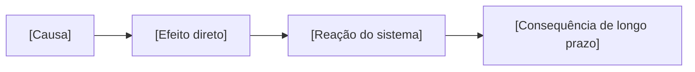

<!-- Template da aula: <material_dir>/NN-slug/README.md.
Substitua tudo entre [colchetes]. Remova seções que não servem ao tema
(ex.: "Mão na massa" numa aula de história vira "Fonte primária comentada").
Toda afirmação factual leva o id do dossiê: [A1], [A2]… e aparece em fontes.md. -->

# [NN] · [Título do tópico]

**Matéria:** [disciplina] · **Nível de entrada:** [0–5] · **Duração estimada:** [min] · **Data:** [AAAA-MM-DD]

> **Em uma frase:** [o que o aluno vai conseguir fazer/explicar ao fim desta aula]

**Antes de começar, você precisa saber:** [pré-requisitos, com link para a aula
anterior; "nada — começamos do zero" quando for o caso]

---

## 1. Por que isso existe?

[O problema real que o conceito resolve. Uma situação do dia a dia ou do
trabalho que o aluno reconheça. Sem termo técnico ainda.]

## 2. A ideia em linguagem de gente

[Analogia do cotidiano. Depois, onde a analogia **para de funcionar** — toda
analogia quebra em algum ponto e o aluno precisa saber onde.]

## 3. Agora com os nomes certos

| Termo | O que é | Exemplo |
|---|---|---|
| [termo] | [definição curta] [A1] | [exemplo concreto] |

## 4. Como X afeta Y

[Mecanismo de causa e efeito: causa → efeito direto → reação do sistema →
consequência de longo prazo.]

Diagrama completo: [`fluxo-conceito.mermaid`](./fluxo-conceito.mermaid) ·
mapa visual: [`mapa-mental.excalidraw`](./mapa-mental.excalidraw)

## 5. Mão na massa

[Exemplo trabalhado passo a passo. Em tecnologia, código que roda com a saída
esperada; em exatas, a conta; em humanas, a fonte primária comentada.]

## 6. Trade-offs e escolas

[Resumo da matriz em [`tabela-comparativa.md`](./tabela-comparativa.md).
Quando o tema tiver lados, cada um com seu melhor argumento e sua fonte.]

| Opção / escola | A favor | Contra | Quando faz sentido |
|---|---|---|---|
| [A] | [..] [A4] | [..] | [..] |
| [B] | [..] [A5] | [..] | [..] |

## 7. Pegadinhas comuns

- **[Equívoco frequente]** — [por que parece certo e por que não é].

## 8. Resumo para lembrar

1. [ideia-chave]
2. [ideia-chave]
3. [ideia-chave]

## 9. Sua vez

Exercícios em [`exercicios.md`](./exercicios.md) · slides em
[`apresentacao.marp.md`](./apresentacao.marp.md) · fontes em [`fontes.md`](./fontes.md)
