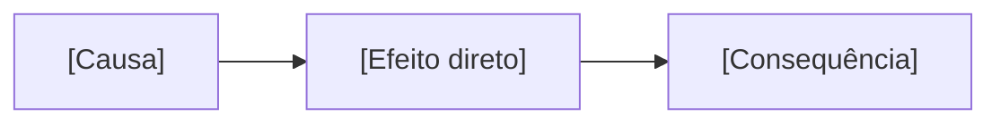

<!-- Template de slides Marp: <material_dir>/NN-slug/apresentacao.marp.md.
Um slide = uma ideia. No máximo 5 bullets por slide. Renderize com:
  npx -y @marp-team/marp-cli apresentacao.marp.md -o apresentacao.html
Fato no slide leva o id do dossiê ([A1]) e está em fontes.md. -->

# [Título do tópico]
## [A pergunta que esta aula responde]

---

# Por que isso existe?

- [O problema real, em uma frase]
- [Quem sofre com ele / onde aparece]

---

# A ideia em linguagem de gente

> [Analogia do cotidiano]

**Onde a analogia quebra:** [limite da analogia]

---

# Como X afeta Y

<!-- Marp não renderiza Mermaid sozinho: exporte o diagrama para SVG
(npx -y @mermaid-js/mermaid-cli -i fluxo-conceito.mermaid -o fluxo-conceito.svg)
e troque o bloco acima por . -->

---

# Trade-offs

| Opção | A favor | Contra |
|---|---|---|
| [A] | [..] | [..] |
| [B] | [..] | [..] |

---

# Pegadinha

- **Parece:** [o equívoco]
- **Na verdade:** [a correção]

---

# Resumo

1. [ideia-chave]
2. [ideia-chave]
3. [ideia-chave]

---

# Sua vez

> **[Pergunta do desafio do dia]**

Exercícios completos em `exercicios.md`.
